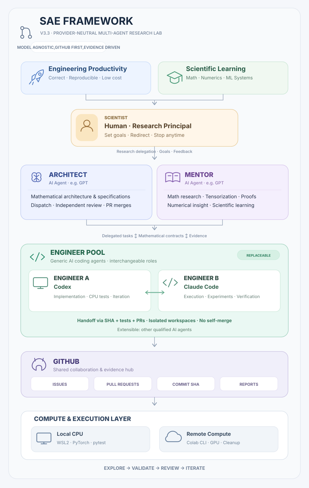
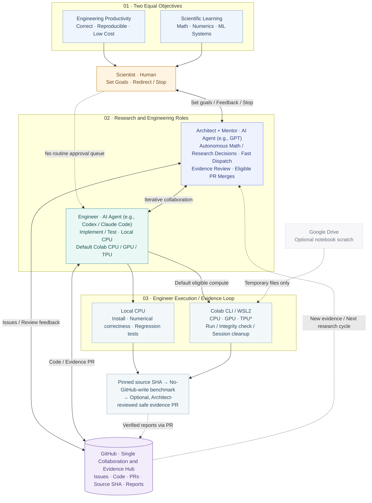

# SAE Framework V3.3

> English normative | [简体中文](README.zh-CN.md)

**Scientist–Architect–Engineer** is a GitHub-first collaboration framework for mathematical algorithms, PyTorch scientific computing and ML engineering. It pursues **two equal goals**: reliable low-cost engineering and the Scientist's deeper mathematical/numerical/ML-systems learning.

## Provider-neutral roles

SAE roles are **capability and authority contracts, not product bindings**: **Scientist** (human), **Architect** (AI agent, e.g., GPT), **Mentor** (AI agent, e.g., GPT), and **Engineer** (AI coding agent, e.g., Codex or Claude Code). One agent may fill Architect and Mentor; multiple Engineers can take turns using separate workspaces and a GitHub Issue/PR + exact-SHA + evidence handoff. Reassignment never transfers credentials, approvals or unverified capabilities. The Engineer never self-merges; the Architect retains the independent review gate. Existing project-pinned snapshots remain unchanged.

## Architecture

Reusable [local preflight and bounded Colab transport](tools/compute/README.md) tools are available for future projects: **SCOPED LIVE_READY (Colab CLI 0.7.4, T4-requested transport-only)** based on [SAE PR #48](https://github.com/JohnnyZPiggy/SAE-Framework/pull/48). Actual device identity was not observed in that transport test. Project-owned drivers/manifests keep scientific code separate; existing pinned snapshots are not migrated.

[Open the full-resolution SVG](docs/figures/SAE_Framework_V3.3.en.svg)

[Editable Mermaid source (.mmd)](docs/figures/SAE_Framework_V3.3.en.mmd)

Editable Mermaid architecture diagram

The bilingual SVG cards above illustrate the **current provider-neutral SAE roles**: two equal objectives → human Scientist → Architect and Mentor (AI agents, e.g., GPT) → interchangeable Engineers (e.g., Codex and Claude Code) → shared GitHub evidence and local/remote execution. The artwork uses self-contained vector shapes, icons and labels (no raster assets, scripts, external fonts or network dependencies). The embedded Mermaid is an alternate **logical** view; the linked `.mmd` retains the historical diagram source for reference and is not the source of the new card SVGs. Diagram artwork does not itself validate experiments.

*TPU/PyTorch-XLA and automated report publication remain unverified.*

## Who does what?
- **Scientist (human):** sets/changes research goals and can stop work; **no routine mathematical, experimental, resource, T3 or PR approvals**.
- **Architect (AI agent; e.g., GPT):** autonomously decides science, mathematical readiness, engineering/experimental acceptance, iterations and eligible PR merges under [Standing Authorization](governance/STANDING_AUTHORIZATION.md).
- **Mentor (AI agent; e.g., GPT):** leads mathematical structure/tensorization research and explains numerical/experimental results.
- **Engineer (AI coding agent; e.g., Codex or Claude Code):** implements, tests and runs eligible existing-account local CPU and Colab CLI CPU/GPU/TPU experiments by default; verifies outputs and resource cleanup; submits safe evidence through GitHub branches/PRs without self-merging.

**GitHub** is the collaboration and evidence hub. **Colab CLI** supplies remote compute. **Drive** is an optional thin notebook workspace, not a sync/results transport.

## Workflow
Mentor/Architect-decided concise [mathematical study](workflows/MATHEMATICAL_RESEARCH.md) + parallel [Build-vs-Reuse](workflows/ECOSYSTEM_REVIEW.md), reference work and `PROBE_ONLY` device checks → Engineer implementation, correctness and eligible compute → GitHub evidence PR → Architect review/iteration/eligible merge. **No Scientist stage signoffs.** Multiple rounds can return to research.

Experiments have **three separate stages**: exact source-SHA install, benchmark **without GitHub writes**, and optional Architect-reviewed, sanitized report publication (separate user permission remains required for sensitive release or new billing). See [Compute Experiment Protocol](workflows/GPU_EXPERIMENT.md); the [historically named compatibility file](workflows/COLAB_TWO_COMMAND.md) remains linked.

## Optional one-click continuation
When the ChatGPT client supports native actions, each completed Architect/Mentor cycle may end with 2–3 clickable **SAE · Next Action** choices that submit a complete instruction in the same conversation. This does not operate an external Engineer desktop window or change SAE authorization. See [Scientist One-Click Next Actions](workflows/SCIENTIST_ONE_CLICK_NEXT_ACTIONS.md); ordinary concise commands remain the fallback.

## Start
Read [AGENTS.md](AGENTS.md), then [Bootstrap V3.3](SAE_BOOTSTRAP.md). Adopt [project AGENTS](examples/project/AGENTS.md) and [sae.yaml](examples/project/sae.yaml) with a **real pinned framework commit SHA**; do not silently upgrade existing projects.

| Role command | Purpose |
| --- | --- |
| `推进导师工作` | Mathematical discovery and scientific learning |
| `推进架构师工作` | Design, delegate, review and decide merges |
| `推进工程师工作` | Implement, execute authorized experiments and submit PR evidence |

These are user-invoked bounded cycles, not a hosted autonomous agent. No default GitHub Actions/paid CI, secrets in reports, fabricated benchmarks or Drive sync.

## Verification status (2026-10-20)
- **Real Colab transport verified:** [SAE PR #48](https://github.com/JohnnyZPiggy/SAE-Framework/pull/48) is merged (merge SHA `c0cb3c1c59073e61bd8f12e54f9e05eaea7bf2e7`). Pinned tool/source `8081b6e02eee0754903898d5afe5b112f1bb23d0` with Colab CLI 0.7.4 passed one genuine T4-requested allocation, kernel probe, driver execution, artifact SHA-256 and authenticated zero-session cleanup. **SCOPED LIVE_READY applies to transport only**; the hardware identity was not observed in this smoke.
- **First scientific CPU/GPU pilot verified:** [TorchYAND PR #22](https://github.com/JohnnyZPiggy/TorchYAND/pull/22) is merged (merge SHA `1ee2a100db61bc3be62ced9cc7923f261b512b35`). Independent Autograd oracle/gradient and a limited simplex/KKT case passed on CPU and a **verified Tesla T4**, with representative eager MVSK `value_grad` CPU/GPU benchmarks. This is one project-specific scientific pilot, not a blanket full-solver or universal speedup claim.
- **Not established:** generic automatic Colab-to-GitHub publisher, bootstrap CLI, multi-project reuse, TPU/PyTorch-XLA and general cross-device readiness. Independent Colab CPU allocation has not been verified in these two PRs. Project-owned Codex publication of evidence via GitHub PR is demonstrated but does **not** establish the generic Publisher.

## Documentation
[Architect](protocols/ARCHITECT.md) · [Engineer](protocols/ENGINEER.md) · [Mentor](protocols/MENTOR.md) · [Scientist](protocols/SCIENTIST.md) · [Role Recovery](workflows/ROLE_RECOVERY.md) · [Changelog](CHANGELOG.md) · [Chinese index](i18n/zh-CN/README.md)

**Version:** V3.3 architecture and protocol; existing pinned V3.2 project snapshots remain unchanged until explicitly upgraded. **License:** [MIT License](LICENSE) · Copyright © 2026 JohnnyZPiggy. The MIT grant covers original content in this repository; any third-party materials retain their own license terms.
