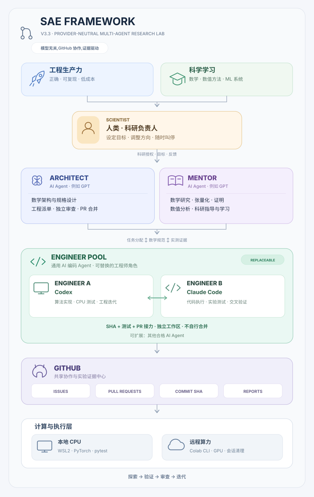
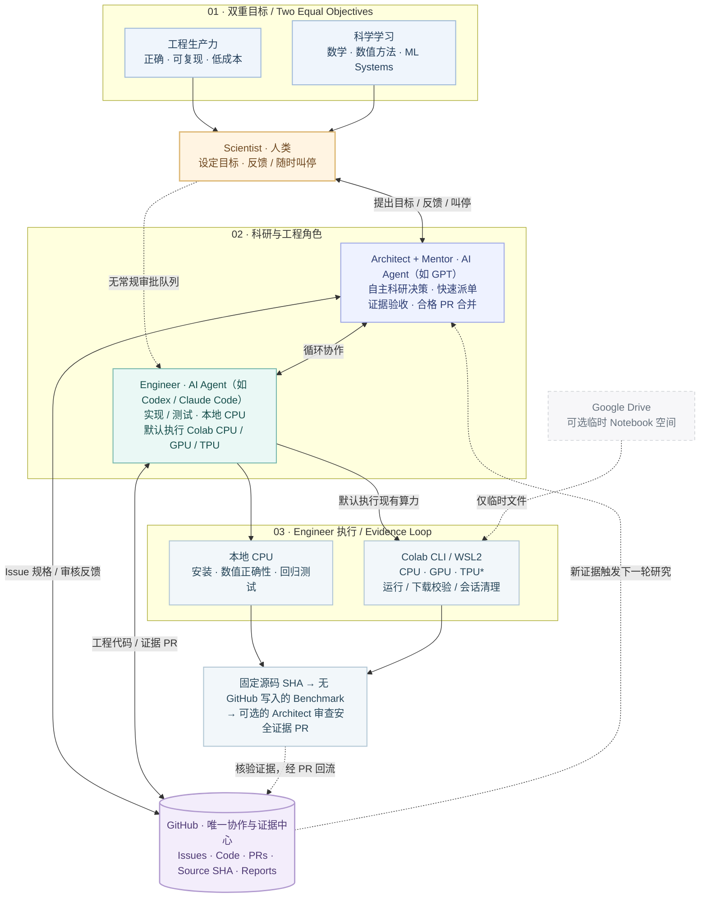

# SAE Framework V3.3

> [English](README.md) 为规范版本 | 简体中文

**Scientist–Architect–Engineer** 是面向数学算法、PyTorch 科学计算和 ML 工程的 GitHub-first 多 Agent 协作框架。两个**同等重要**的目标：**工程生产力**（可靠、可复现、低成本）与**科学学习**（数学、数值计算、PyTorch 和异构计算能力）。

## 通用 AI Agent 角色

SAE 的角色由**职责、能力与权限**定义，而非绑定具体模型：**Scientist**（人类）、**Architect**（AI Agent，例如 GPT）、**Mentor**（AI Agent，例如 GPT）、**Engineer**（AI 编码 Agent，例如 Codex、Claude Code）。Architect 和 Mentor 可以由同一 Agent 担任；多个 Engineer 可以轮流接力，但必须经 GitHub Issue/PR、精确 SHA 和测试证据交接，使用独立工作区。更换 Agent 不会自动转移凭据或授权；Engineer 不得自审或自行合并。已有项目固定快照不自动升级。

## 组织架构图

未来项目可使用[本地预检与有界 Colab 传输工具](tools/compute/README.zh-CN.md)：基于 [SAE PR #48](https://github.com/JohnnyZPiggy/SAE-Framework/pull/48)，已获得 **SCOPED LIVE_READY（Colab CLI 0.7.4、请求 T4 的 transport-only 路径）**；该次纯传输实验未直接核实实际设备型号。driver 与 manifest 由算法项目提供；不会迁移旧项目的固定快照。

[查看高清 SVG 矢量原图](docs/figures/SAE_Framework_V3.3.zh-CN.svg)

[可编辑 Mermaid 源码 (.mmd)](docs/figures/SAE_Framework_V3.3.zh-CN.mmd)

展开 GitHub 原生可渲染的 Mermaid 架构图

上方中英文 SVG 卡片图展示当前**通用 AI Agent 角色架构**：双重目标 → 人类 Scientist → Architect 与 Mentor（例如 GPT）→ 可轮流接力的 Engineer（例如 Codex、Claude Code）→ GitHub 共享证据和本地/远程执行层。图中的卡片、图标、文字和箭头均为独立矢量元素，不依赖外部图片、脚本、字体文件或网络资源。上方 Mermaid 是另一种**逻辑视图**；链接的 `.mmd` 保留历史图的编辑源码，并非新版卡片 SVG 的源文件。架构图不代表相关计算实验已经验收。

*TPU/PyTorch-XLA 与自动发布仍须实测。*

## 角色
- **Scientist（人类）：** 提出或调整科研目标、随时叫停，**不再负责日常数学、实验、资源、T3 或 PR 审批**。
- **Architect（AI Agent，例如 GPT）：** 自主决定数学研究、科研准备、工程/实验验收、迭代和合格 PR 合并，依[常设授权](governance/STANDING_AUTHORIZATION.md)执行。
- **Mentor（AI Agent，例如 GPT）：** 研究数学结构、张量化与数值方法，指导科研学习。
- **Engineer（AI Agent，例如 Codex、Claude Code）：** 实现、测试并默认执行现有账户本地 CPU 和 Colab CLI CPU/GPU/TPU 实验，校验结果、释放资源，经 GitHub 分支/PR 提交证据；不自合并。

**GitHub** 是任务、代码与证据中心；**Colab CLI** 提供远程计算；**Drive** 只作可选轻量 Notebook 工作空间，不同步实验结果。

## 工作模式
Mentor/Architect 自主判断简明[数学结构研究](workflows/MATHEMATICAL_RESEARCH.md)，与 Architect [生态复用评估](workflows/ECOSYSTEM_REVIEW.md)、参考实现和有界 `PROBE_ONLY` 探针并行 → Engineer 实现/数值测试/直接实验 → GitHub 证据 PR → Architect 审核、迭代或合并，**无需 Scientist 逐环节审批**。可以多轮返回数学研究，不是固定单向流水线。

实验保留**三个独立阶段**：固定源码 SHA 安装、**不写 GitHub** 的 Benchmark、可选且经 Architect 审核的安全非敏感报告发布。详见[计算实验协议](workflows/GPU_EXPERIMENT.md)和[保留历史文件名的兼容入口](workflows/COLAB_TWO_COMMAND.md)。

## 可选：一键继续下一轮
当前 ChatGPT 客户端支持原生交互时，Architect/Mentor 每轮完成后可展示 2～3 个 **SAE · 下一步行动** 可点击选项；点击即可在当前对话提交完整指令。它不控制外部 Engineer 桌面窗口，也不改变 SAE 授权和科研验收标准。详见 [Scientist One-Click Next Actions](workflows/SCIENTIST_ONE_CLICK_NEXT_ACTIONS.md)；无法提供原生控件时保留简短指令。

## 快速开始
阅读[共同宪章](i18n/zh-CN/AGENTS.zh-CN.md)与[初始化协议 V3.3](i18n/zh-CN/SAE_BOOTSTRAP.md)。采用[项目 AGENTS](examples/project/AGENTS.md)、[sae.yaml](examples/project/sae.yaml)，固定到**真实不可变 SAE commit SHA**；旧项目不自动升级。

| 口令 | 用途 |
| --- | --- |
| `推进导师工作` | 数学研究、科学学习 |
| `推进架构师工作` | 设计、派单、审核、决定合并 |
| `推进工程师工作` | 实现、直接实验、提交 PR 证据 |

口令是用户触发的有边界工作周期，不代表后台自主服务。不默认使用 GitHub Actions/付费 CI、不泄密、不虚报实验、不通过 Drive 同步结果。

## 验证状态（2026-10-20）
- **真实 Colab 传输已验收：** [SAE PR #48](https://github.com/JohnnyZPiggy/SAE-Framework/pull/48) 已合并（`c0cb3c1c59073e61bd8f12e54f9e05eaea7bf2e7`）。固定工具源码 `8081b6e02eee0754903898d5afe5b112f1bb23d0`、CLI 0.7.4，一次真实请求 T4 的分配、Kernel 探针、driver 执行、文件 SHA-256 校验及认证可信零活动会话清理通过。**LIVE_READY 仅限传输范围**；该次实验未直接观察硬件身份。
- **首个科学 CPU/GPU 试点已验收：** [TorchYAND PR #22](https://github.com/JohnnyZPiggy/TorchYAND/pull/22) 已合并（`1ee2a100db61bc3be62ced9cc7923f261b512b35`）。独立 Autograd 梯度对照、限定的 simplex/KKT 测试，以及实际确认的 Tesla T4 上的 MVSK `value_grad` CPU/GPU 对照与性能实验通过。仅支持该次试点的结论，不代表通用求解器加速保证。
- **仍未完成/验证：** 通用实验 Publisher、Bootstrap CLI、跨多个算法项目的复用、TPU/PyTorch-XLA 和通用异构兼容性；这两项 PR 未单独验证 Colab CPU 分配。Codex 已通过 PR 发布真实结果，但不等于通用 Publisher 已实现。

## 文档
[架构师](i18n/zh-CN/protocols/ARCHITECT.md) · [工程师](i18n/zh-CN/protocols/ENGINEER.md) · [导师](i18n/zh-CN/protocols/MENTOR.md) · [科学家](i18n/zh-CN/protocols/SCIENTIST.md) · [角色恢复](i18n/zh-CN/workflows/ROLE_RECOVERY.md) · [变更记录](i18n/zh-CN/CHANGELOG.md) · [中文导航](i18n/zh-CN/README.md)

**版本：** V3.3 文档迁移中；已固定的 V3.2 项目快照须经审查后主动升级。**许可：** [MIT License](LICENSE) · Copyright © 2026 JohnnyZPiggy。本许可适用于仓库内的原创内容；如含第三方素材，其原有许可条款仍然适用。
