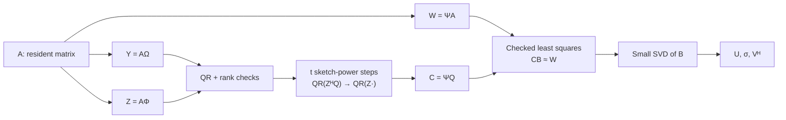

# TorchSketchPower

**Research-grade PyTorch implementation of sketch-power low-rank approximation**  
*Numerical linear algebra · Randomized algorithms · CPU/CUDA experiments · Reproducible research*

[Mathematics](docs/math.md) · [Quickstart](#quickstart) · [Experimental findings](#experimental-findings) · [Reproducibility](#reproducibility) · [Documentation](docs/README.md)

> **Research snapshot — October 2026.** The numerical implementation and historical experiments are archived; new work is paused. This is a source-available research repository, **not** a released or fully validated high-performance library. See [scope and limitations](#scope-and-limitations).

TorchSketchPower explores sketch-power iterations for low-rank matrix approximation using **native PyTorch tensor and linear-algebra operators**. It combines randomized range finding, QR-stabilized sketch-power updates, numerically checked least-squares recovery and a small SVD. The project investigates not only whether an algorithm *works*, but **where it fails, what it costs, and what the evidence actually supports**.

Inspired by Chang & Yang (2026), [*Improving Sketching Algorithms for Low-Rank Matrix Approximation via Sketch-Power Iterations*](https://doi.org/10.1137/25M1760143). This is an independent implementation and **not** a verified reproduction of the paper's complete Algorithm 2.1.

## At a glance

| Capability | Current evidence |
|:--|:--|
| **PyTorch-native** | Tensorized sketching, QR, SVD, least squares; no custom CUDA/Triton kernels |
| **Numerical contracts** | Explicit rank-deficiency errors, conditioning warnings and complex conjugate-adjoint support |
| **CPU + Tesla T4** | CPU testing and a **bounded real-T4** numerical verification; not universal device validation |
| **Performance studies** | Eager comparisons with `torch.svd_lowrank`, partial `torch.compile` capture and preserved negative results |
| **Reproducibility** | Exact tested source SHAs, raw JSON/CSV, environment metadata, hashes and archived failed cases |
| **Project status** | Research archived; no tagged release, **no license granted** |

## How it works

For a resident matrix (A in mathbb{F}^{m 	imes n}), target rank (r), sketch dimensions (s,ell,d) and `steps=t`:



In mathematical form, the subspace is refined by

```text
Y = A Ω,   Z = A Φ,   W = Ψ A
Q₀ = orth(Y)
Qₜ₊₁ = orth(Z · orth(Zᴴ Qₜ))
B = argmin_B ||(ΨQ) B − W||_F
Âᵣ = Uᵣ diag(σᵣ) Vᵣᴴ
```

**Important distinction:** `Z Zᴴ` is never formed, and the power updates reuse the auxiliary sketch `Z`. Nevertheless, the *current code accesses resident `A` through three matrix products*; it is **not** a validated one-pass or streaming implementation. Details: [math and numerical assumptions](docs/math.md).

## Quickstart

Use a Python environment with PyTorch installed. The repository declares Python `>=3.10` and PyTorch `>=2.2`; those entire version ranges have **not** been exhaustively tested.

```bash
git clone https://github.com/JohnnyZPiggy/TorchSketchPower.git
cd TorchSketchPower
python -m pip install .
```

```python
import torch
from torchsketchpower import sketch_power_low_rank

gen = torch.Generator().manual_seed(7)
A = torch.randn(120, 80, generator=gen, dtype=torch.float64)

U, sigma, Vh = sketch_power_low_rank(
    A,
    r=8,
    s=12,
    ell=24,
    d=24,
    steps=1,
    generator=torch.Generator().manual_seed(42),
)

A_hat = (U * sigma) @ Vh
relative_error = torch.linalg.matrix_norm(A - A_hat) / torch.linalg.matrix_norm(A)

print(A_hat.shape)             # torch.Size([120, 80])
print(float(relative_error))
```

**Rank safety is deliberate.** Default calls raise `RankDeficiencyError` if the required sketch or cross-product becomes numerically rank-deficient. The checked corange solve issues `IllConditionedWarning` for a poorly conditioned `ΨQ`. Results are not guaranteed to exist for every matrix/parameter choice.

For CUDA, use a matching device-resident matrix and CUDA `torch.Generator`, within the specifically tested Gaussian path. [Review the bounded T4 evidence](docs/RESEARCH_CLOSEOUT.md) before relying on accelerator behavior.

## Experimental findings

We publish failures alongside successes. These are **scoped observations**, not headline claims of speedup.

| Study | Finding | Trace |
|:--|:--|:--|
| **M4–M5 · CPU numerics** | Synthetic-spectrum accuracy and an exact error-decomposition audit, including corange-recovery error | [CPU results](docs/cpu-results.md) |
| **M7 · GPU correctness** | Real Tesla T4: **171 oracle checks passed**; one second-device-only check **not run** | [M7 record](reports/m7_cuda/m7-t4-20261022-185647/m7-cuda-report.json) |
| **M8 · Accuracy vs cost** | Second run: **75/80** full configurations completed. Native `torch.svd_lowrank(niter=1)` won the measured paired subset; a strict float64 oracle discrepancy remains unresolved | [M8 review](reports/m8_gpu/m8-ref-t4-20261022-195451/review.md) |
| **M9 · Compilation** | Some pure tensor graphs compile, but the checked pipeline graph-breaks. **All three measured T4 Inductor comparisons were slower** than eager; initial compile calls cost seconds | [M9 review](reports/m9_compile/m9-t4-20261022-204314/review.md) |
| **M10 · Cost modeling** | Symbolic flop, memory and synchronization analysis; no manufactured GPU stage timings | [Cost DAG](experiments/m10_cost/README.md) |
| **M11 · Counterexample** | **17/140** CPU configurations violated the proposed concatenated-GEMM equivalence criterion, including a rank-branch and RNG-state divergence. Unrestricted substitution rejected | [M11 review](reports/m11_concat/m11-20261022-214747/review.md) |

For the complete evidence trail, tested-source identities, historical failed numerical gates and caveats, see the **[Research Closeout & Evidence Index](docs/RESEARCH_CLOSEOUT.md)**. The proposed spectral phase diagram ([M12](https://github.com/JohnnyZPiggy/TorchSketchPower/issues/28)) was **not run**.

### Why the negative results matter

- **Numerical correctness before optimization.** A seemingly harmless GEMM concatenation can change rounding enough to cross a rank threshold and alter exception/RNG behavior.
- **Measure what is actually timed.** First-call compilation, synchronized wall time and allocator statistics have different meanings; a successful graph capture is not a speedup.
- **Fair baselines need matched constraints.** `torch.svd_lowrank` uses a different computational and matrix-access contract, so measured comparisons are descriptive, not equal-work algorithm proofs.

## Reproducibility

Run the existing CPU regression suite after installing test dependencies:

```bash
python -m pip install pytest
python -m pytest -q
```

The archive provides:
- `src/torchsketchpower/` — production implementation and numerical contracts.
- `tests/` — regression and negative-control tests.
- `experiments/` — experiment runners, mathematical prototypes and benchmark methodology.
- `reports/` — raw outputs, trial-level timing data, adverse cases, manifests and SHA-256 provenance.
- `docs/` — derivations, CPU results, historical GPU readiness and research closeout.
- `.sae/`, `sae.yaml` — pinned [SAE](https://github.com/JohnnyZPiggy/SAE-Framework) Scientist–Architect–Engineer workflow snapshot.

**Historical CPU/GPU counts belong to their exact run environments and tested source SHAs.** A new checkout is not promised to reproduce byte-identical floating-point results on every backend. Do not infer that the entire GPU suite or every declared dependency version has been validated.

## Scope and limitations

TorchSketchPower is a **research implementation**, currently archived rather than an installable stable release. It does **not** claim:

- equivalence to the paper's complete algorithm or a true one-pass/streaming data pipeline;
- superiority to PyTorch native low-rank implementations, generalized GPU acceleration or production-ready `torch.compile`;
- blanket correctness for all shapes, dtypes, devices, spectra or rank-threshold cases;
- a validated TPU backend or custom CUDA implementation.

The project **does not currently include a root `LICENSE`**. Source visibility does not itself grant permission to copy, redistribute or reuse the code. Please contact the repository owner for licensing questions; no public package release or version tag has been approved.

## Documentation and provenance

[Documentation index](docs/README.md) · [Mathematical formulation](docs/math.md) · [CPU error studies](docs/cpu-results.md) · [Research archive](docs/RESEARCH_CLOSEOUT.md) · [Historical GPU audit](docs/gpu-readiness.md) · [Scientific research notes](docs/research/spi-tensorization.md)

**Reference:** Chao Chang and Yuning Yang, *Improving Sketching Algorithms for Low-Rank Matrix Approximation via Sketch-Power Iterations*, *SIAM Journal on Matrix Analysis and Applications* 47(3), 2026, [DOI:10.1137/25M1760143](https://doi.org/10.1137/25M1760143). The [upstream MATLAB repository](https://github.com/Mitchell-Cxyk/SketchPowerIteration) was studied for context but its source code was not copied.

**Research workflow:** [SAE V3.3](https://github.com/JohnnyZPiggy/SAE-Framework) with reproducible GitHub Issues, PR-based independent reviews and a fixed framework snapshot. The documented outcomes include successful tests, incomplete trials and deliberately preserved negative results.
