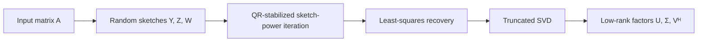

# TorchSketchPower

**Randomized low-rank approximation with PyTorch**  
*Numerical Linear Algebra · Scientific Computing · CPU & GPU · Reproducible Research*

[Quickstart](#quickstart) · [Mathematics](#algorithm) · [Results](#research-highlights) · [Documentation](docs/README.md) · [MIT License](LICENSE)

TorchSketchPower is a PyTorch implementation of **Sketch-Power Iterations** for low-rank matrix approximation. It combines randomized matrix sketches, QR-stabilized subspace iteration, least-squares recovery, and truncated SVD in a compact, testable numerical library.

Built with native PyTorch operations, the project includes CPU/CUDA numerical validation, reproducible benchmarks, and studies of compiler behavior and mathematical optimizations.

## Highlights

- **PyTorch-native:** vectorized matrix operations and CPU/CUDA execution.
- **Numerically robust:** QR stabilization, rank checks, conditioning diagnostics, and real/complex dtype support.
- **Research-oriented:** accuracy analysis, PyTorch baseline comparisons, and `torch.compile` experiments.
- **Reproducible:** numerical tests, raw CPU/T4 data, exact commit provenance, and archived experiment reports.

## Quickstart

```bash
git clone https://github.com/JohnnyZPiggy/TorchSketchPower.git
cd TorchSketchPower
python -m pip install .
```

```python
import torch
from torchsketchpower import sketch_power_low_rank

A = torch.randn(120, 80, dtype=torch.float64)
U, sigma, Vh = sketch_power_low_rank(
    A, r=8, s=12, ell=24, d=24, steps=1,
    generator=torch.Generator().manual_seed(42),
)

A_hat = (U * sigma) @ Vh
error = torch.linalg.matrix_norm(A - A_hat) / torch.linalg.matrix_norm(A)
print(f"Relative Frobenius error: {error:.4f}")
```

For reproducible results, seed the matrix generation separately from the algorithm. The Gaussian CUDA path uses device-matched inputs and a CUDA generator.

## Algorithm

Given a matrix `A`, three random sketches are formed:

```math
Y = A\Omega,\qquad Z=A\Phi,\qquad W=\Psi A.
```

The auxiliary sketch drives a QR-stabilized power iteration:

```math
Q_0=\operatorname{orth}(Y),\qquad
Q_{t+1}=\operatorname{orth}\!\left(Z\,\operatorname{orth}(Z^H Q_t)\right).
```

Finally, the algorithm solves the corange least-squares problem and computes a small SVD:

```math
B=\underset{B}{\operatorname{argmin}}\ \|(\Psi Q)B-W\|_F,
\qquad \widehat A_r=U_r\Sigma_r V_r^H.
```



The sketch-power iterations reuse `Z` to refine the subspace. The current implementation targets **in-memory matrices**. See [mathematical details](docs/math.md) and the [research notes](docs/research/spi-tensorization.md).

## Research highlights

| Area | Results | Evidence |
|---|---|---|
| **Numerical accuracy** | Synthetic-spectrum studies and error decomposition | [CPU studies](docs/cpu-results.md) |
| **GPU validation** | 171 numerical-oracle checks passed on an NVIDIA Tesla T4 | [M7](reports/m7_cuda/m7-t4-20261022-185647/m7-cuda-report.json) |
| **Low-rank benchmarks** | 75/80 configurations fully measured in the second CPU/T4 study; comparison with `torch.svd_lowrank` | [M8](reports/m8_gpu/m8-ref-t4-20261022-195451/review.md) |
| **PyTorch compilation** | Examined graph capture, compilation overhead, and eager/compiled execution on T4 | [M9](reports/m9_compile/m9-t4-20261022-204314/review.md) |
| **Mathematical optimization** | FLOP/memory/synchronization models and reproducible floating-point counterexamples | [M10](experiments/m10_cost/README.md) · [M11](reports/m11_concat/m11-20261022-214747/review.md) |

The measured T4 configurations favored PyTorch's native low-rank baseline in the studied regime, and the experiments also identified a rank-boundary case where a GEMM refactor changed execution behavior. These findings help characterize the algorithm's numerical and performance trade-offs.

Read the complete [research summary and experiment index](docs/RESEARCH_CLOSEOUT.md).

## Project structure

```text
src/torchsketchpower/  PyTorch implementation
tests/                Numerical and regression tests
experiments/          Experiment drivers and research prototypes
reports/              Raw measurements and reproducibility records
docs/                 Mathematics, findings, and technical notes
.sae/                 Pinned Scientist–Architect–Engineer workflow
```

To run the tests:

```bash
python -m pip install pytest
python -m pytest -q
```

## Reference

Inspired by Chao Chang and Yuning Yang, *Improving Sketching Algorithms for Low-Rank Matrix Approximation via Sketch-Power Iterations*, **SIAM Journal on Matrix Analysis and Applications**, 2026. [DOI: 10.1137/25M1760143](https://doi.org/10.1137/25M1760143).

Developed with the [SAE (Scientist–Architect–Engineer)](https://github.com/JohnnyZPiggy/SAE-Framework) research workflow.

## License

Distributed under the [MIT License](LICENSE). Copyright © 2026 Ru Zhang.
