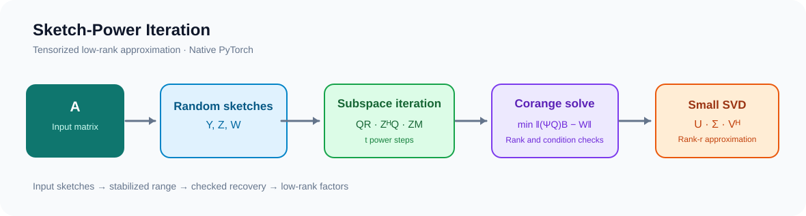

# TorchSketchPower

[English](README.md) | [简体中文](README.zh-CN.md)

**基于原生 PyTorch 的随机化低秩矩阵近似。**

TorchSketchPower 实现 Sketch-Power Iterations，将随机矩阵草图、QR 稳定化子空间迭代、带数值检查的最小二乘恢复和截断 SVD 整合为 PyTorch 数值计算流程。项目提供数学推导、CPU/CUDA 数值实验、性能研究和可复现的实验数据。

   

**项目导航：** [数学推导](docs/math.md) · [实验结果](docs/RESEARCH_CLOSEOUT.md) · [CPU 研究](docs/cpu-results.md) · [GPU 基准测试](reports/m8_gpu/m8-ref-t4-20261022-195451/review.md) · [文档](docs/README.md)

## 项目亮点

- **原生 PyTorch：** 基于矩阵运算实现随机草图、QR、最小二乘和 SVD，支持 CPU/CUDA。
- **数值稳定性：** 秩亏检测、条件数诊断，以及复数矩阵的共轭转置支持。
- **Sketch-Power 迭代：** 重用辅助草图进行子空间精化。
- **可复现科研：** 保留源代码版本、CPU/T4 原始数据、基准记录及数值反例。
- **科学计算工程：** 将算法实现、正确性测试和性能实验整合到统一的研究工作流。

## 算法架构



算法从输入矩阵构造两个右侧草图和一个余域草图，通过 QR 稳定化的 Sketch-Power 迭代提取子空间，再使用小规模最小二乘问题和截断 SVD 恢复低秩因子。

对于稠密矩阵 \(A\in\mathbb{F}^{m\times n}\)、草图尺寸 \(s,\ell,d\) 和目标秩 \(r\)：

$$
Y=A\Omega,\quad Z=A\Phi,\quad W=\Psi A,\qquad
Q_0=\operatorname{orth}(Y).
$$

$$
Q_{t+1}=\operatorname{orth}\bigl(Z\,\operatorname{orth}(Z^H Q_t)\bigr),\qquad
B=\underset{B}{\operatorname{argmin}}\,\|(\Psi Q_t)B-W\|_F.
$$

最终返回秩为 \(r\) 的截断分解 \(\widehat A_r=U_r\Sigma_r V_r^H\)。当前实现面向内存中的矩阵，幂迭代阶段重用辅助草图 \(Z\)。详细证明及数值约定见[数学文档](docs/math.md)。

## 安装与快速开始

从仓库安装（Python >=3.10、PyTorch >=2.2）：

```bash
git clone https://github.com/JohnnyZPiggy/TorchSketchPower.git
cd TorchSketchPower
python -m pip install .
```

```python
import torch
from torchsketchpower import sketch_power_low_rank

matrix_rng = torch.Generator().manual_seed(7)
A = torch.randn(120, 80, generator=matrix_rng, dtype=torch.float64)

U, sigma, Vh = sketch_power_low_rank(
    A, r=8, s=12, ell=24, d=24, steps=1,
    generator=torch.Generator().manual_seed(42),
)

A_hat = (U * sigma) @ Vh
relative_error = torch.linalg.matrix_norm(A - A_hat) / torch.linalg.matrix_norm(A)
print(f"Relative Frobenius error: {relative_error:.4f}")
```

使用 Gaussian CUDA 路径时，输入矩阵与随机数生成器需要配置在对应的 CUDA 设备上。库还提供草图构造函数、子空间迭代核、余域恢复和数值诊断接口。

## 性能与科研结果

项目保存了真实 NVIDIA Tesla T4 实验以及 CPU 数值分析。所有性能数据均可追溯到对应的测试范围与实验报告。

| 研究方向 | 主要结果 | 证据 |
|---|---|---|
| **CPU 精度与误差分析** | 合成谱实验、误差分解与数值验证 | [M4–M5](docs/cpu-results.md) |
| **CUDA 正确性** | 真实 T4 上 **171 个数值基准检查通过** | [M7](reports/m7_cuda/m7-t4-20261022-185647/m7-cuda-report.json) |
| **PyTorch 原生方法对照** | 第二轮实验 **75/80** 组完成完整计时；已测配对配置下原生 `torch.svd_lowrank` 更快 | [M8](reports/m8_gpu/m8-ref-t4-20261022-195451/review.md) |
| **`torch.compile`** | 局部图捕获、graph break 与编译开销分析；已测三个 T4 Inductor 配对均慢于 eager | [M9](reports/m9_compile/m9-t4-20261022-204314/review.md) |
| **数学与优化研究** | FLOPs/内存成本模型，以及 GEMM 合并影响秩阈值的可复现反例 | [M10](experiments/m10_cost/README.md) · [M11](reports/m11_concat/m11-20261022-214747/review.md) |

完整源代码版本、原始实验数据及研究结论见[科研证据索引](docs/RESEARCH_CLOSEOUT.md)。

## 应用与研究方向

| 方向 | 潜在用途 |
|---|---|
| 低秩矩阵近似 | 研究高维稠密矩阵的紧凑表示 |
| 子空间估计 | 通过随机草图分析主导奇异子空间 |
| 科学计算 | 比较不同矩阵谱与存储预算下的草图精度 |
| GPU 数值算法 | 分析 QR、SVD、最小二乘与 PyTorch 执行开销 |

## 仓库结构

```text
src/torchsketchpower/   PyTorch 核心实现
tests/                 数值与回归测试
experiments/           研究实验及基准测试
reports/               原始测量和复现证据
docs/                  数学推导与技术文档
.sae/                  Scientist–Architect–Engineer 工作流快照
```

运行 CPU 测试：

```bash
python -m pip install pytest
python -m pytest -q
```

## 学术引用

项目受 **Chao Chang 与 Yuning Yang** 的论文 *Improving Sketching Algorithms for Low-Rank Matrix Approximation via Sketch-Power Iterations* 启发，发表于 *SIAM Journal on Matrix Analysis and Applications*（2026）。[DOI: 10.1137/25M1760143](https://doi.org/10.1137/25M1760143)。

开发采用 [SAE（Scientist–Architect–Engineer）框架](https://github.com/JohnnyZPiggy/SAE-Framework)。

## 开源许可

[MIT License](LICENSE) · Copyright © 2026 Ru Zhang。
