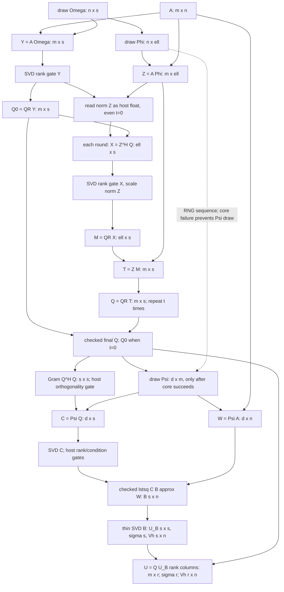

# M10: Sketch-Power cost DAG and synchronization audit

CPU-only research for Issue #24; base main `345ee660bd1baed2c7a9c5ae7c58ec45f6feff93`, immutable SAE `65338eb1aa67971e110db982a07cf43161c23446`. No production, protocol, dependency, compiler, driver or historical-evidence changes. No GPU/Colab invocation, installs or new timing benchmark. `run_m10.py` reuses existing PyTorch/public checked functions. Its two prototypes are research only, not API replacements.

## Evidence and limits of causal interpretation

All five raw files below are read in full; their SHA256, exact source SHA and recomputed aggregates are in the new observations manifest. Paths are relative to repository root.

| Raw evidence | actually tested source | scope retained |
|---|---|---|
| `reports/m7_cuda/m7-t4-20261022-185647/m7-cuda-report.json` | `645777724845207fbb882329c086f59dc5da8b04` | real T4 numerical oracle171PASS/1single-device NOT_RUN; pytest98PASS/1SKIP; original driver PYTHONPATH provenance and bounded-log caveats remain |
| `reports/m8_gpu/m8-t4-20261022-193439/results.json` | `e986a1b03abf772e383778865ef47d16687bb77d` | 60/80 full configs; historical near-flat float32 reference audit FAIL; native niter1 smaller median wall/no-worse Fro in20/20 completed paired GPU SPI configs |
| `reports/m8_gpu/m8-ref-t4-20261022-195451/results.json` | `116d6c299b3b84a3477363c2529f6efd37972055` | 75/80 full configs,380calls; final float64 dense-SVD configured EY FAIL; native advantage26/26 completed GPU SPI pairs |
| `reports/m9_compile/m9-t4-20261022-204314/cpu-results.json` | `988a1b170f2b9f56eef3a3e21f71bbdb5b68290e` | 4SUPPORTED/5GRAPH_BREAK/2UNSUPPORTED; Windows public Inductor missing-cl failure |
| `reports/m9_compile/m9-t4-20261022-204314/gpu-results.json` | same M9 SHA | T4 4SUPPORTED/6GRAPH_BREAK/1UNSUPPORTED; checked public steps0/1 have10/12 breaks; fullgraph Generator failure |

M8 sessions overlap cases: do not pool20+26 into46 independent trials. The second run's final five configs have cold calls only (four accuracy PASS/one FAIL); five warmups+15warm calls NOT_RUN. Neither M8 run is full-grid PASS. T4 M9 warm median eager/Inductor ms: helperf32 0.178/0.418, helperf64 0.872/1.010, publicf64steps1 14.902/15.690; first compile+run4–8s. Three warm repeats, one seed/session, no replicated speedup conclusion. aot_eager is not optimized codegen. Events include stream idle, allocator deltas are not true per-call/device-wide allocation, thermal/clock variability unquantified.

These total-call observations show a scoped negative result. They do NOT measure time fractions for RNG, QR, gates, least squares or SVD, physical A traffic, or synchronization latency. The model below offers mechanisms compatible with the data; it does not establish which dominates T4 wall time. GPU stage attribution/roofline calibration is NOT RUN.

## Exact successful-path DAG

Resident dense A(m,n), r<=s<=min(m,n), ell>s, d>=s, t>=0, Gaussian draws, no gradients. The stronger n>=s is necessary for a successful default rank check; the public signature permits some s>n inputs that then raise. ell may exceed m. Conjugate transpose is H. Arrows are dependencies, not evidence of concurrent execution.

Initially Omega and Phi are both drawn before Y/Z GEMMs; Psi is drawn later. Python/default-stream order and first-failure behavior matter. A different schedule may preserve algebra while changing errors or RNG advancement on failure. The t-round region is `X=Z^H Q; gate(X); M=QR(X); Q=QR(Z M)`; it never forms the m-by-m operator Z Z^H. Reconstruction also never forms Q B.

## Symbolic real-arithmetic costs

Count scalar real multiply/add as1each (FMA2); leading GEMM2abc drops lower-order subtractions. For a>=s, reduced Householder factorization is about2as²-2s³/3; explicitly forming Q costs another2as²-2s³/3. Thus define Qcost(a,s)=4as²-4s³/3, a **classical model**, not exact cuSOLVER/LAPACK work. Complex GEMM leading real cost is8abc under6-real-op complex multiply/2-op add; do not apply the real QR/SVD constants blindly to complex implementations.

| stage | calls/shapes | leading FLOPs / order |
|---|---|---|
| random sketches | Omega(n,s),Phi(n,ell),Psi(d,m) | n(s+ell)+dm random entries; complex has two real components; RNG implementation cost UNKNOWN |
| Y,Z,W | three GEMMs | 2mn(s+ell+d) |
| initial rank gate Y | svdvals(m,s) | O(ms²+s³), iteration/backend-dependent constants |
| initial reduced QR | QR(m,s) | Qcost(m,s) |
| each power round | Z^H Q(ell,s),Z M(m,s) | 4m ell s |
| each power round QR | QR(ell,s),QR(m,s) | Qcost(ell,s)+Qcost(m,s) |
| each power rank gate | svdvals(ell,s) | O(ell s²+s³) |
| norm Z | reduction, even t=0 | O(m ell), real about2m ell; not in GEMM subtotal |
| Q orthogonality gate | Q^H Q, subtract identity/norm | 2ms²+O(s²) |
| C | Psi Q(d,s) | 2dms |
| rank/condition C | svdvals(d,s) | O(ds²+s³) |
| CUDA gels model only | QR(C), apply Householders to W, triangular solve | about2ds²-2s³/3+4dsn-s²n, lower-order terms omitted |
| CPU gelsd model only | rank-revealing SVD solve | O(ds²+s³+dsn+s²n); no exact driver constant asserted |
| thin SVD B | SVD(s,n), n>=s | O(ns²+s³); singular-vector generation/iterations/workspace backend-dependent |
| final U | Q U_B(:,1:r) | 2msr |

Totals: **6+2t GEMMs**, **1+2t explicit-Q QRs**, **t+2 svdvals**, **one thin SVD**, **one lstsq**. GEMM subtotal=2mn(s+ell+d)+4tm ell s+2ms²+2dms+2msr. All gate costs are additional. No exact flop constant for iterative SVD, GPU launch count or allocator workspace is invented.

For historical M8 m1024/n512/r8/s16/ell32/d32/t1: GEMM subtotal87,818,240 real FLOPs; explicit-Q QR model2,113,536 FLOPs; three rank-SVD calls plus one thin SVD and one solve remain outside that subtotal. Source-level scalar consumptions8. `observations.json` includes12 modeled combinations (three M8 shapes,steps0/1,4/8bytes), not new GPU workloads.

Native context: the published PyTorch2.11 `svd_lowrank` tall path uses A R, then niter alternating A^H/A products with QR, then Q^H A and small SVD. For q=s, its A-GEMM leading cost is4(niter+1)mnq, plus final2mq² and QRs/SVD. In M8 niter1/q16 means128mn A-product FLOPs; SPI initial sketches alone use160mn for s16/ell32/d32, then more work. Native does not implement SPI's rank/conditioning policy. Fewer native FLOPs/auxiliary gates are a plausible explanation, not equal arithmetic or measured stage attribution. Published source is context, not a binary audit of the exact installed cu130 build.

## Matrix access, residency and hardware separation

Three **logical GEMM uses** of A are not three observed physical full-memory passes: cache/tile reuse, layout, precision and vendor packing decide actual traffic. A is fully resident, not host-streamed; no one-pass guarantee. No new device/host tensor copy occurs in the baseline successful math DAG other than scalar consumptions; metadata/device validation is separate.

Let b=bytes/entry. Individual payloads: A bmn; Omega/Phi bn(s+ell); Y/Z bm(s+ell); Q bms; each cross/middle b ell s; Psi bdm; W bdn; C bds; Gram/R each bs²; B logical bsn; U_B bs²; thin Vh bsn; Uout bmr; sigma bs. These are **per-tensor logical footprints, not a sum asserted as peak**. Omega/Phi die after sketch construction; Y/Z remain referenced by lowrank while Q/Psi/W/reconstruction are live. During a power QR, old Q/product/new Q and cross/middle can overlap. SVD/QR/gels have extra copies/workspace; B may retain d*n backing storage even though logical shape is s*n. No backend-independent workspace upper bound is claimed. Returning sigma[:r],Vh[:r] views can retain s and s*n backing payloads; U is freshly m*r. Autograd retention is outside this no-gradient model. Physical peak must be measured, not inferred from these logical sizes; stored M8/M9 peaks have their original allocator caveats.

For a standalone real GEMM A(m,n)X(n,k), an ideal operand-boundary traffic model is b(mn+nk+mk), giving arithmetic intensity2mnk/[b(mn+nk+mk)]. This ignores cache/inter-call reuse and workspace. Roofline lower bound max(F/P,Q/BW) needs calibrated throughput P and physical bytes Q/BW. Neither is measured here; source sync/launch latency is not a known additive constant, and stages/barriers may overlap. A fitted total-call time cannot identify those components.

H1's separate Y/Z operand model is b(2mn+nk+mk), k=s+ell. Cat plus joint GEMM is b(mn+3nk+mk), including reading+writing the cat buffer. Ideal difference bn(m-2k) can be positive, zero or negative; it is **not a prediction of DRAM traffic saved**. M8 1024x512/f32: cat buffer98,304bytes, ideal operand saving1,900,544bytes; actual output views have row stride k instead of s/ell, and downstream packing may require another bm k transient. Explicit extra cat/optional repack payload range is bn k to b(n+m)k; backend workspace is still unbounded by this estimate. FLOPs and RNG work do not decrease.

## Host control and required semantics

Successful default source-path scalar consumers (not measured CUDA barriers):

- Each numerical-rank call consumes one tensor truth value in Python `max(s.max(),scale)` and one `int(sum(...))`:2(t+1).
- One `float(norm(Z))` even when t=0.
- Corange consumes `float(gram_err)`, `float(sv[0])`, `float(sv[-1])`:3. Total **2t+6**; corange rank failure adds an integer for the diagnostic rank, while earlier exceptions short-circuit later work/RNG.

CPU profiler records ATen scalar-extraction counts for the unmodified t0/t1 pipeline and prototype rank gate; current torch2.14.1 CPU observations are11/14 whole-pipeline extractions (not the6/8 source-only count),3for an original rank gate versus2for the prototype, with one extraction already inside svdvals. Library validation adds events beyond the source inventory; this tests source inventory, **not CUDA sync time**. `svdvals` itself documents CUDA/CPU synchronization, so library synchronization can add to/collapse with scalar boundaries. QR/lstsq/backend/error checks may add other barriers. Do not add API-sync counts to scalar counts as independent hardware stalls. M9's item and Generator breaks support the existence of control boundaries, not their latency share.

To preserve semantics retain Y rank failure before QR, cross-rank failure at its original step with norm-Z scale, Q orthogonality rejection before C/SVD, C rank rejection before CUDA gels, original condition limit/warning, and exception messages/order. Gathering Gram/max/min host values together computes C/SVD before an invalid-Q rejection; NaNs or backend failure could replace the original error. Such aggregation changes fail-fast/work/error behavior and is **DEFERRED**, not a free equivalent optimization.

## Ranked hypothesis register (only two)

| rank | hypothesis / classification | proof and falsifier | impact/risk and decision |
|---|---|---|---|
|1|H1: draw Omega and Phi separately in original order, then Y/Z=A cat(Omega,Phi). **CONDITIONAL**; exact algebra, not a proven all-input floating-point/API contract.|Linearity proves blocks agree over exact F. CPU checks4dtypes,steps0/1, final generator state, public reconstruction/residual, zero-rank failure. Any RNG mismatch, reconstruction beyond fixed existing-oracle tolerances or changed exception rejects that domain. Near-threshold rank/condition decisions and CUDA all-input equivalence remain unproved.|Same asymptotic/FLOPs, two A-GEMM calls become one; extra cat/copies/noncontiguous outputs may lose. M8 large initial sketch cost motivates inspection; M9 helper compile slower refutes naive 'capture alone wins', not this untested concatenation. **PROCEED only to independent CPU/API review**, no production or GPU approval here. A single wide RNG call is a distinct, rejected variant: it does not reproduce separate draws.|
|2|H2: keep the SVD/rank gate but choose max(smax,scale) on the device before the required host rank integer. **CONDITIONAL**.|For finite real singulars and representable nonnegative scale, max is mathematically identical. Test default0 and native-representable2, zero/rank-deficient and both sides/exact threshold in4dtypes. Prototype retains same SVD and final int. Any rank/warning/message/first-failure change falsifies the target contract; arbitrary Python-scale rounding, NaN/Inf, extreme magnitudes and CUDA remain unverified.|Can remove one source scalar consumption per gate (t+1), not the SVD sync or required rank branch. Prototype `new_tensor(scale)` adds allocation and on CUDA potentially an H2D scalar copy plus pointwise work; savings can be zero/negative. M9 item breaks motivate but do not quantify benefit. **DEFER production/performance work** until nonfinite/promotion/exception and transfer costs are reviewed. CPU extraction counts are not speed evidence.|

No future benchmark is run/authorized by a PROCEED label; GPT independently decides next scope.

## Other requested alternatives: obligations and negative controls, not added hypotheses

- **Reuse W=Psi A from Y,Z: REJECT as a general identity.** If n>rank[Omega Phi], choose Delta=u v^H with v orthogonal to both right sketches and Psi u nonzero. Then Delta Omega=Delta Phi=0 but Psi Delta!=0. CPU constructs this counterexample in4dtypes. If right sketches span all n, recovering A needs additional solves and stability/independence proof; no one-pass or free reuse follows. Reusing sketch randomness to force a relation changes the randomized algorithm.
- **Replace checked gels with normal equations: REJECT as a drop-in.** C^H C squares condition number; explicit full-rank near-parallel C makes its Gram singular in working precision, while the checked CPU gelsd solve warns and succeeds. Direct QR/triangular or SVD solve may be mathematically valid for full-column-rank C, but backend cost, stability, driver warning/rank/error contracts and residuals need separate proof. CUDA gels assumes full rank; removing its preceding gate is not equivalent. No CPU result predicts CUDA solve speed.
- **SVD of B versus Q B: already implemented.** With Q^H Q=I, (QB)^H(QB)=B^H B, preserving nonzero singulars and rank-r Frobenius solution. For nonorthogonal Q this fails: perturbation B^H(Q^H Q-I)B has norm <=||B||²||Q^H Q-I||. CPU skew-Q example changes singulars and existing gate rejects it. Reusing a QR/SVD of a different matrix requires new identities, numerical rank/scale and exception proof; not justified here.
- **Fixed steps / independent RNG streams:** static loop length does not remove data-dependent gate control; independent streams or reordered Psi draws change seeded replay and failure-state advancement. No automatic parallel schedule or unguarded algorithm is treated as equivalent.

## CPU reproduction and interpretation

Use the **existing** CPU environment; no install command or dependency change. The script verifies normalized production .py text matches its reused installed package, pins experimental HEAD/clean state, reads full original evidence, uses one CPU thread and emits raw observations+SHA256 manifest. Small matrices only;8H1 cases,32H2 threshold cases,4sets of counterexamples and a few CPU-only profiler calls. No wall-time comparison is performed. Tests are deterministic numerical/protocol regression checks, not mirrored performance assertions.

    python -I -m pytest tests/test_m10_cost.py tests/test_core.py tests/test_lowrank.py tests/test_reconstruct.py -q -p no:cacheprovider
    python -I experiments/m10_cost/run_m10.py --source-sha EXACT_SHA --out NEW_DIRECTORY

Evidence may support arithmetic consistency in this bounded domain, not all-input API equivalence, formal distribution independence, CUDA speedup or new production acceptance. Both hypotheses remain experimental. Future GPU work is NOT_RUN and requires a separate Architect-scoped task; Engineer does not merge.

References: [PyTorch2.11 native lowrank source](https://github.com/pytorch/pytorch/blob/v2.11.0/torch/_lowrank.py) (algorithmic context only), [PyTorch2.11 svdvals synchronization](https://docs.pytorch.org/docs/2.11/generated/torch.linalg.svdvals.html), [LAPACK Householder QR source](https://netlib.org/lapack/explore-html/d3/d69/dgeqrf_8f_source.html), [LAPACK QR cost discussion](https://netlib.org/lapack/lawnspdf/lawn224.pdf). Counts above are explicit classical derivations/models, not vendor timing claims.
